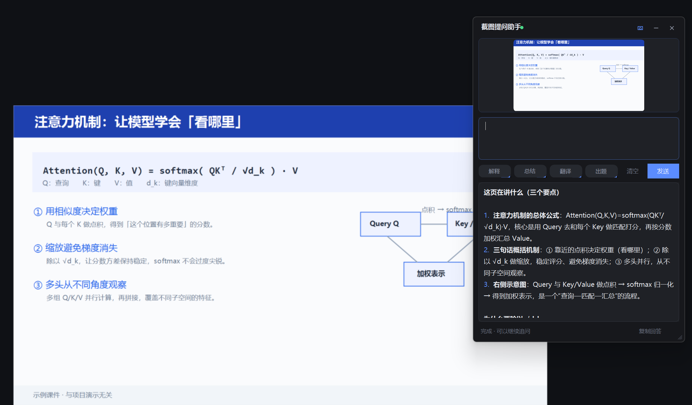

# 截图提问助手（DSH 版）

> 看 PPT、网课、论文时，按一下热键框选屏幕上的任意一块，直接在悬浮窗里问 AI。
> 截图和回答都在本机完成，模型复用你已登录的 [DeepSeek Harness](https://github.com/deepseek-ai)。

[](LICENSE)
[](#系统要求)
[](#系统要求)

> 本项目是第三方工具，**与 DeepSeek 官方无关**。DeepSeek Harness 的安装与使用请参考官方文档。



---

## 它解决什么问题

看课件时遇到看不懂的公式、图表、代码，通常要：截图 → 切到浏览器 → 粘贴 → 打字 → 再切回来。
这个工具把这一串压缩成 **框选 + 一句话**：悬浮窗常驻在 PPT 上方，`Ctrl+Alt+Q` 框选后直接在窗里问，
答案流式出现在同一块区域，不用切窗口，也不打断你看下一页。

## 功能

- **热键框选截图**：`Ctrl+Alt+Q` 冻结屏幕、拖拽选区；`Esc` 取消，回车 / 双击选全屏，支持多显示器。
- **置顶悬浮窗**：无边框、可拖动、右下角拖拽缩放、`—` 折叠成小胶囊、`×` 收进托盘。
- **流式回答**：逐字输出，轻量 Markdown 渲染（标题 / 加粗 / 列表 / 代码块）。
- **快捷提问**：解释 / 总结 / 翻译 / 出题，点一下直接问。
- **连续追问**：自动带最近几轮问答作为上下文。
- **零依赖**：C# WinForms 单文件 exe，Windows 10/11 自带 .NET Framework 4.8 即可运行。
- **隐私优先**：截图只发往 `127.0.0.1` 上的 DSH 插件，不经过任何第三方服务器。

## 系统要求

| 项目 | 要求 |
| --- | --- |
| 系统 | Windows 10 / 11（x64） |
| 运行时 | 无需安装；使用系统自带 .NET Framework 4.8 |
| DSH | DeepSeek Harness ≥ 0.2.2（提供 `ctx.llm`、`ctx.webServer`、`ctx.attachments`） |
| 模型 | 支持图片输入的模型（当前默认的 DeepSeek-V4.1-Flash 即可） |

## 安装（3 分钟）

### 1. 装插件

1. 启动 DSH，打开 `http://127.0.0.1:3080`；
2. 左侧 **插件 → 添加插件**，选择本仓库的 `plugin` 目录；
3. 插件列表出现 **截图提问助手接口** 即成功。

> 插件是「本地目录链接」方式安装的，**不要移动或删除 `plugin` 目录**；移动后重新添加一次即可。

### 2. 启动浮窗

双击 `dist\启动截图提问助手.bat`，或直接运行 `dist\截图提问助手.exe`。
浮窗出现在屏幕右上角，托盘同时出现图标。

### 3. 用起来

按 `Ctrl+Alt+Q` → 拖拽框选 → 输入问题 → `Enter`。

## 工作原理

```
┌──────────────────┐   POST /shot-ask/ask    ┌────────────────────────────┐
│  截图提问助手.exe │ ──────────────────────▶ │  DSH 插件 dsh-shot-ask      │
│  截图 + 问题      │                         │  · 附件校验与缩放           │
│                  │ ◀──── SSE 流式回答 ──── │  · ctx.llm.stream 调用模型  │
└──────────────────┘                         └────────────────────────────┘
                                                          │
                                              你当前的默认模型与账号
```

- 浮窗只负责截图、选区和界面，不含任何模型密钥。
- 插件把截图交给 DSH 的附件服务校验、缩放，再作为图片消息发给模型。
- 全过程走 `127.0.0.1`，截图不出本机。

## 配置

首次运行后在 exe 同目录生成 `config.json`，改完重启生效。

| 字段 | 默认值 | 说明 |
| --- | --- | --- |
| `BaseUrl` | `http://127.0.0.1:3080` | DSH 本地服务地址；端口不同时只改这一项 |
| `Hotkey` | `Ctrl+Alt+Q` | 截图热键，支持 `Ctrl+Alt+A`、`Alt+S`、`Ctrl+Shift+1` 等 |
| `HistoryDepth` | `6` | 追问时携带的最近问答轮数（0 = 不带） |
| `MaxImageSide` | `1600` | 截图长边上限（像素） |
| `JpegQuality` | `85` | 截图压缩质量，50–95 |
| `QuickQuestions` | `解释\|总结\|翻译\|出题` | 快捷按钮，用 `\|` 分隔 |
| `Width` `Height` `X` `Y` | 自动 | 窗口位置与大小，程序会记住 |

## 常见问题

**热键没反应？**
热键可能被其他软件占用。标题栏右侧的圆点变红即表示注册失败，改 `Hotkey` 后重启程序。

**状态显示「未连接 DSH」？**
先启动 DSH，确认浏览器能打开 `http://127.0.0.1:3080`；端口不同则改 `BaseUrl`。

**PPT 全屏放映时浮窗被盖住？**
PowerPoint 的「窗口化放映」下浮窗可以盖在上面；独占全屏请改用窗口化放映，或把浮窗拖到副屏。

**回答报错或很慢？**
先在 DSH 网页里确认模型能正常对话，浮窗使用的是同一套模型通道。

## 从源码构建

只需要 Windows 自带的 C# 编译器，无需安装 .NET SDK：

```powershell
powershell -ExecutionPolicy Bypass -File .\build.ps1
```

产物：`dist\ShotAsk.exe` 与 `dist\截图提问助手.exe`。

## 目录结构

```
.
├─ src/                    浮窗的 C# 源码
├─ plugin/                 DSH 本地接口插件（Host 端，纯 JS）
├─ dist/                   构建产物（不入库）
├─ docs/                   截图与文档
├─ build.ps1               一键编译
└─ scripts/test-ask.mjs    直接打接口的联调脚本
```

## 已知限制

- 仅 Windows；跨平台需要重写 UI 层（Electron/Tauri 会牺牲「单 exe 零依赖」的优势）。
- 依赖 DSH 的 Host API，DSH 大版本升级可能需要适配。
- 截图区域不做 OCR 兜底；模型本身需要支持图片输入。
- 暂不支持把问答写回 DSH 会话历史（在 Roadmap 中）。

## Roadmap

- [ ] 把问答写回对应的 DSH 会话，方便之后翻查
- [ ] 多屏场景下按显示器快速框选
- [ ] 可自定义的快捷提问模板
- [ ] 截图区域自动 OCR，作为不支持图片模型时的兜底

## 参与贡献

欢迎 Issue 和 PR，尤其是：新的快捷提问模板、多屏快捷选择、把问答写回 DSH 会话。
请先阅读 [CONTRIBUTING.md](CONTRIBUTING.md)。

## 安全与隐私

截图只在本机回环地址内传输，详见 [SECURITY.md](SECURITY.md)。

## English

**Screenshot Ask (DSH edition)** — a tiny always-on-top Windows companion for
[DeepSeek Harness](https://github.com/deepseek-ai): press `Ctrl+Alt+Q`, drag a region
of the screen (a slide, a chart, a paper), and ask a question about it. Answers stream
back in the same floating window. Screenshots never leave `127.0.0.1`.

## License

[MIT](LICENSE) © 2026 ShotAsk contributors

维护者：首次发布到 GitHub 的完整步骤见 [docs/PUBLISHING.md](docs/PUBLISHING.md)。
